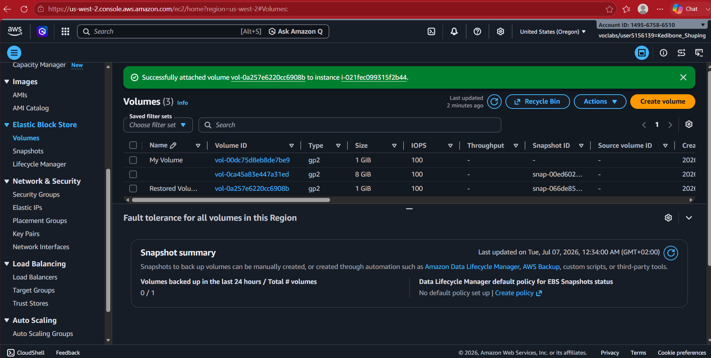

# Amazon EBS (Elastic Block Store)

## Overview

This lab demonstrated how Amazon Elastic Block Store (EBS) provides persistent block storage for Amazon EC2. I created an EBS volume, attached it to an EC2 instance, formatted and mounted it in Linux, wrote data to the volume, and then used an EBS snapshot to restore the volume's data to a new volume.

## AWS Services and Components Used

- Amazon EBS
- Amazon EC2
- Amazon EBS Snapshots
- Amazon Linux
- Linux filesystem and mount utilities

## Project Workflow

1. Created a 1 GiB `gp2` EBS volume in the same Availability Zone as the EC2 instance.
2. Attached the volume to the EC2 instance using the EC2 device mapping `/dev/sdb`.
3. Created an `ext3` filesystem and mounted the volume at `/mnt/data-store`. The Linux terminal identified the attached device by its NVMe name, `/dev/nvme1n1`.
4. Added a mount entry to `/etc/fstab` and verified the mounted storage with `df -h`. The configuration was checked, but a reboot test was not captured.
5. Created `file.txt` on the EBS volume and verified that the file was accessible.
6. Created an EBS snapshot of the volume.
7. Deleted the original `file.txt` and verified that it was no longer present.
8. Created a new EBS volume from the snapshot and attached it to the EC2 instance using the EC2 device mapping `/dev/sdc`.
9. Mounted the restored volume at `/mnt/data-store2` and confirmed that `file.txt` was visible on the restored volume.

## Technical Context

Amazon EBS provides block storage designed for use with EC2. Unlike ephemeral instance storage, EBS volumes are persistent independently of the lifecycle of the EC2 instance.

The exercise also demonstrated the relationship between an EBS volume and its snapshot. A snapshot provides a point-in-time backup from which a new EBS volume can be created. In this lab, I tested that recovery path by deleting a file from the original volume and then mounting a new volume created from the snapshot. The terminal evidence shows the file present on the restored volume.

On the Linux side, the exercise required creating a filesystem, mounting the block device, configuring `/etc/fstab`, and using standard Linux commands to verify storage and file operations. The EC2 device mappings (`/dev/sdb` and `/dev/sdc`) are distinct from the NVMe device names shown inside the Linux instance.

## Screenshots

### 1. EBS Volume Attached to EC2

The EBS volume is listed as attached to the Lab EC2 instance.

---

### 2. Restored EBS Volume

The restored EBS volume is associated with the snapshot and shown attached to the EC2 instance.

---

### 3. Linux Mounting and File Recovery

The terminal shows the Linux storage workflow, including the mount configuration, filesystem checks, file creation and deletion, and the restored file appearing after the snapshot-based volume was mounted.

## Skills Demonstrated

- Created and managed Amazon EBS volumes
- Attached block storage to an EC2 instance
- Formatted and mounted a Linux block device
- Configured a mount entry using `/etc/fstab`
- Used Linux commands to inspect and verify storage
- Created and used EBS snapshots for data recovery
- Restored an EBS snapshot to a new volume
- Confirmed that a file was present on the restored volume

## What I Learned

This lab reinforced the difference between block storage and the compute instance using it. I also gained practical experience with the EBS storage lifecycle: provisioning a volume, attaching and mounting it, writing data, creating a snapshot, and restoring that snapshot to a new volume.

The recovery exercise showed how an EBS snapshot can provide a recoverable point-in-time copy of a volume, allowing data to be restored to a new EBS volume when needed.
