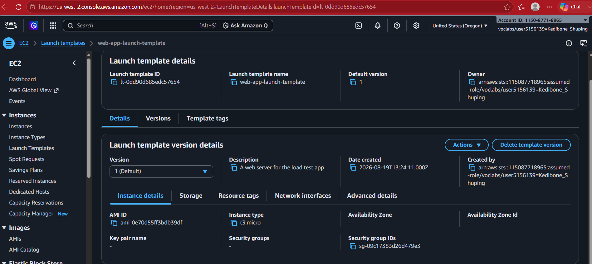
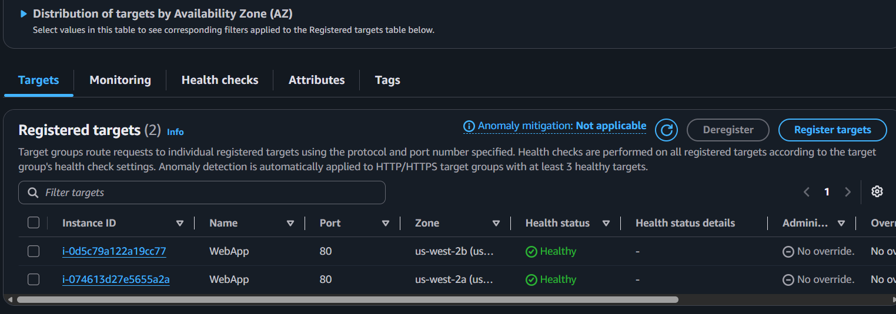
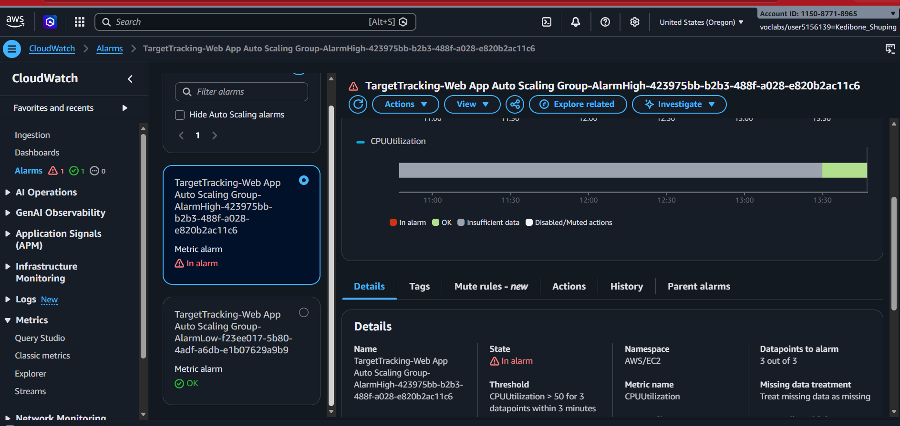
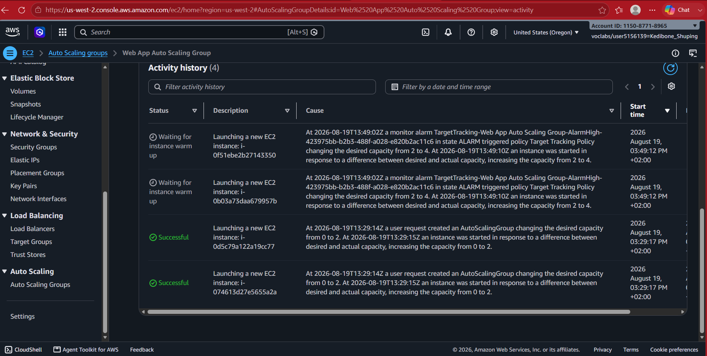

# Scaling and Load Balancing Your Architecture

## Overview

In this lab, I built a highly available, automatically scaling web application architecture using Amazon EC2, an Application Load Balancer, an EC2 Auto Scaling group, and Amazon CloudWatch.

I began with an existing web server and created an Amazon Machine Image (AMI) from it. I then used that image in an EC2 launch template so that the Auto Scaling group could launch matching application instances when additional capacity was needed.

The completed architecture distributed incoming requests across healthy instances in two Availability Zones. I generated CPU load to observe the monitoring and scaling response.

## Architecture and Service Roles

Each service had a distinct responsibility:

- **Application Load Balancer (ALB):** provided a single application entry point and distributed incoming HTTP requests.
- **Target group:** registered the application instances and reported their health to the load balancer.
- **EC2 launch template:** defined how new application instances should be created, including the AMI, instance type, and security group.
- **EC2 Auto Scaling group:** maintained the required number of instances across two Availability Zones and adjusted capacity when demand changed.
- **Amazon CloudWatch:** supplied the CPU utilisation monitoring used by the target-tracking scaling policy.

The load balancer distributed traffic; it did not create or manage the instances. The Auto Scaling group managed the EC2 capacity, while the launch template supplied the configuration for instances it launched.

## Configuration

I configured the architecture with the following settings:

- Created an AMI from the original web server.
- Created the launch template `web-app-launch-template` using that AMI, a `t3.micro` instance type, and the required security group.
- Configured an Application Load Balancer listening on HTTP port 80 and forwarding requests to the application target group.
- Created an Auto Scaling group spanning two Availability Zones.
- Set minimum capacity to **2**, desired capacity to **2**, and maximum capacity to **4**.
- Added a target-tracking scaling policy targeting average CPU utilisation of **50%**.

The load balancer operated in public subnets, while the Auto Scaling instances were placed in private subnets across the two Availability Zones.

## How Scaling Worked

With two application instances running, I generated CPU load against the web application.

CloudWatch recorded the increase in CPU utilisation. When the scaling condition was met, the target-tracking policy initiated a scale-out. The Auto Scaling Activity History showed the desired capacity increasing from **2 to 4**, followed by the launch of additional EC2 instances.

This demonstrated the relationship between the services: the ALB distributes requests across healthy targets, while the Auto Scaling group changes the amount of compute capacity available to handle those requests.

## Architecture Diagram

```text
                         Incoming requests
                                |
                                v
                    Application Load Balancer
                                |
                                v
                           Target Group
                                |
             +------------------+------------------+
             |          EC2 Auto Scaling Group     |
             |                                     |
             |       EC2 instance   EC2 instance   |
             |       (AZ 1)         (AZ 2)         |
             +------------------^------------------+
                                |
                      Desired capacity adjusts
                                |
                    Target-tracking policy
                                ^
                                |
                       CloudWatch metrics
                         (CPU utilisation)
```

The Auto Scaling group owns and manages the EC2 instances. The target group registers those instances as load-balancer targets and checks their health. CloudWatch metrics inform the target-tracking policy when capacity needs to change.

## Evidence and Verification

The screenshots below show the key configuration and the outcome of the test. They are selected evidence of the working architecture rather than a record of every console action.

### 1. EC2 launch template

The launch template uses the AMI created from the original web server and specifies the `t3.micro` instance type. This provides the reusable instance configuration for the Auto Scaling group.



### 2. Healthy load-balancer targets

The target group shows two registered application targets in separate Availability Zones, both reporting **Healthy**. This confirms that the load balancer had healthy instances available to receive traffic.



### 3. CloudWatch high-CPU alarm

The `AlarmHigh` CloudWatch alarm entered the **In alarm** state when CPU utilisation exceeded the configured **50%** threshold during the load test.



### 4. Auto Scaling scale-out

The Auto Scaling Activity History records the desired capacity increasing from **2 to 4** in response to the scaling activity. This is the key evidence that the architecture responded to increased load by adding compute capacity.



## Skills Demonstrated

- Creating and using an Amazon Machine Image (AMI)
- Configuring EC2 launch templates
- Deploying an Application Load Balancer and target group
- Configuring an EC2 Auto Scaling group across Availability Zones
- Applying target-tracking scaling based on CPU utilisation
- Monitoring application infrastructure with CloudWatch
- Generating load and verifying scale-out activity
- Using the AWS CLI to create an AMI and troubleshoot configuration issues

## Key Takeaway

This lab connected load balancing, compute capacity, and monitoring into one working architecture. The Application Load Balancer distributed requests to healthy application instances, while the Auto Scaling group adjusted the number of instances available. Under increased CPU load, the target-tracking policy increased desired capacity from two instances to four.

The practical lesson was understanding not just what each service does individually, but how they work together to keep an application responsive as demand changes.
