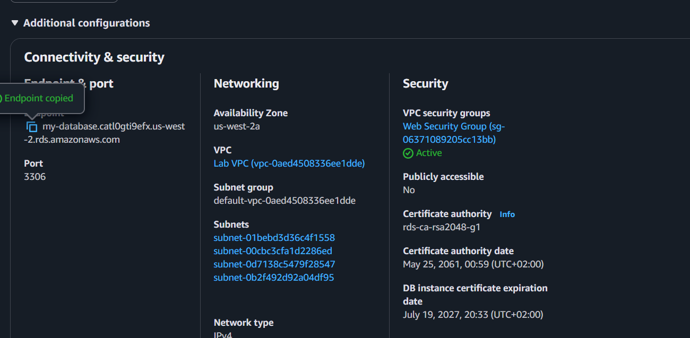
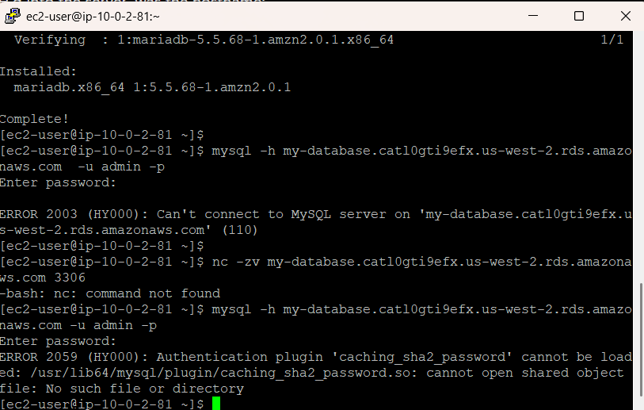
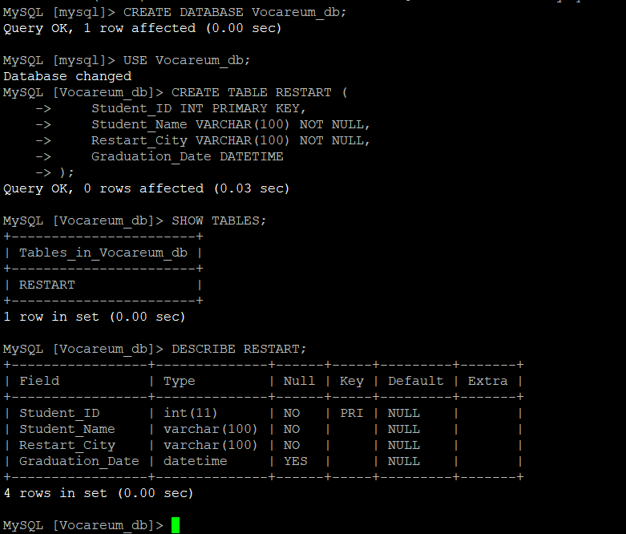
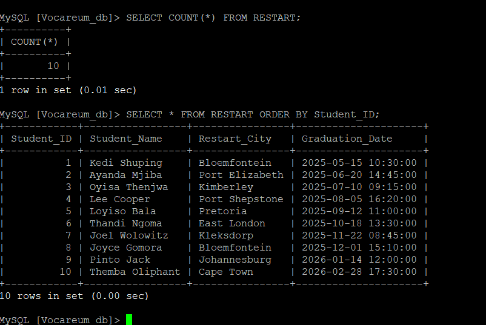
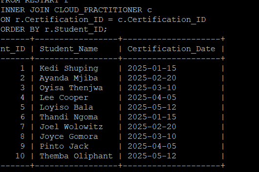

# Build and Access an RDS Server

## Overview

In this lab, I set up an Amazon RDS for MySQL database and connected to it from a Linux server running on Amazon EC2. I created a database, built two tables, added records, and used an `INNER JOIN` to bring related information together.

## AWS Services and Tools Used

- Amazon RDS for MySQL
- Amazon EC2
- Amazon VPC
- Security Groups
- Amazon Linux 2
- PuTTY
- MariaDB / MySQL command-line client
- SQL

## Setting Up the Database

I used Amazon RDS to host the MySQL database and an EC2 instance as the Linux environment from which I accessed it. The RDS instance was configured as not publicly accessible and used port `3306`.



I connected to the Linux server using SSH through PuTTY, then prepared the command-line client so I could work with the database from the terminal.

## Troubleshooting Along the Way

The first few attempts did not go smoothly. I initially tried to use `apt` to install the database client, but the server was running Amazon Linux 2, so that command was not available. I also had to deal with a missing MySQL client, a connection timeout, and a client authentication-plugin error.

The SSL option I tried was not recognised by the installed MariaDB client either. These errors helped narrow down the problem: some were related to the Linux environment, some to the client itself, and others to connecting to the RDS instance.



Once I had a working SQL session, I ran into a few database-level errors. I tried to create a table before selecting a database, then attempted to create one inside the protected `mysql` system database. I corrected this by creating my own database, `Vocareum_db`, and selecting it before creating the tables.

## Creating and Populating the Tables

I created two tables in `Vocareum_db`:

- `RESTART`
- `CLOUD_PRACTITIONER`

I added the records and queried the tables to check that the data had been inserted correctly.



I also checked the records returned by the queries and confirmed that the student table contained ten rows.



## Joining the Data

The final task was to retrieve the student ID, student name, and certification date from both tables. The tables shared a `Certification_ID` field, which I used to match the related records.

```sql
SELECT
    RESTART.Student_ID,
    RESTART.Student_Name,
    CLOUD_PRACTITIONER.Certification_Date
FROM RESTART
INNER JOIN CLOUD_PRACTITIONER
    ON RESTART.Certification_ID = CLOUD_PRACTITIONER.Certification_ID
ORDER BY RESTART.Student_ID;
```

The `INNER JOIN` returned the ten matching records with the requested information.



## What I Learned

- How to connect to an Amazon RDS for MySQL database from an EC2 Linux environment.
- Why the operating system and database client matter when choosing commands and connection options.
- How to use error messages to narrow down connection, compatibility, and SQL problems.
- How to create a database, build tables, insert records, and verify the results.
- How an `INNER JOIN` uses a shared field to combine related records from two tables.

## Challenges Encountered

Along the way, I ran into a few problems with the Linux environment, the database client, the connection, and my SQL statements. Working through those errors was just as valuable as getting the final query to run.
