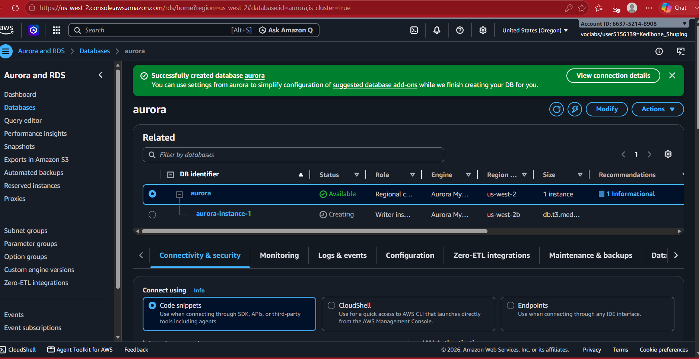
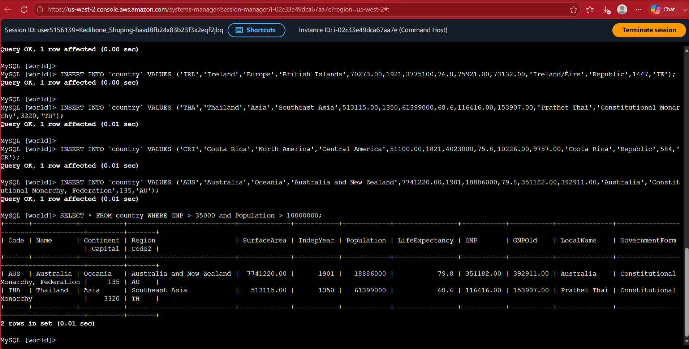

# Introduction to Amazon Aurora

## Overview

In this lab, I created an Amazon Aurora MySQL-compatible database cluster, connected to the lab's Command Host through AWS Systems Manager Session Manager, and worked with the `world` database. I created and populated a `country` table, then ran a conditional query against the data.

## AWS Services and Tools Used

- Amazon Aurora (MySQL-Compatible)
- Amazon RDS
- Amazon EC2
- AWS Systems Manager Session Manager
- Amazon VPC
- MariaDB / MySQL command-line client
- SQL

## Creating the Aurora Cluster

I used the standard database creation workflow in Amazon RDS and selected Aurora (MySQL-Compatible). The lab configuration used:

- **Cluster identifier:** `aurora`
- **Initial database:** `world`
- **Instance class:** `db.t3.medium`
- **Deployment:** Aurora cluster without an Aurora Replica
- **VPC:** `LabVPC`
- **DB subnet group:** `dbsubnetgroup`
- **Public access:** No
- **Security group:** `DBSecurityGroup`

The cluster creation completed successfully. The console screenshot shows the `aurora` cluster in the Available state and its writer instance, `aurora-instance-1`, being created.



## Connecting from the Command Host

I opened a Session Manager session to the lab's EC2 instance named **Command Host**. From that Linux environment, I installed the MariaDB client:

```bash
sudo yum install mariadb -y
```

I then used the Aurora writer endpoint with the database username to connect from the command line. The lab database password is intentionally not included in this repository.

The writer endpoint provides the connection target for database operations. The lab did not create an Aurora Replica, so a separate reader endpoint was not needed for this exercise.

## Working with the World Database

After connecting, I selected the `world` database and worked with a `country` table containing country information such as code, name, continent, region, population, life expectancy, and GNP.

I populated the table with the country records supplied in the exercise and ran the required conditional query:

```sql
SELECT *
FROM country
WHERE GNP > 35000
  AND Population > 10000000;
```

The query returned two matching records:

- Australia
- Thailand

The terminal screenshot shows the query and its two-row result in the Command Host Session Manager session.



## What I Learned

- How to create an Aurora MySQL-compatible DB cluster through Amazon RDS.
- How cluster and DB instance resources appear separately in the RDS console.
- How to use an EC2 Command Host and Systems Manager Session Manager to access a Linux environment.
- How to install and use a MariaDB command-line client.
- How to connect a client to an Aurora writer endpoint.
- How to select a database, work with a relational table, and filter query results using multiple conditions.
