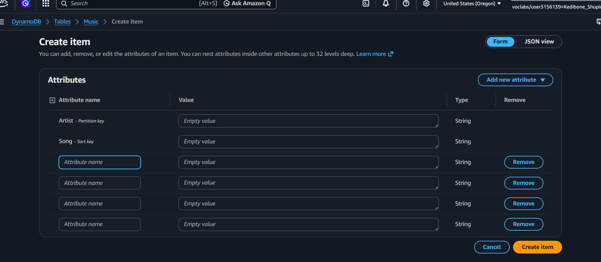
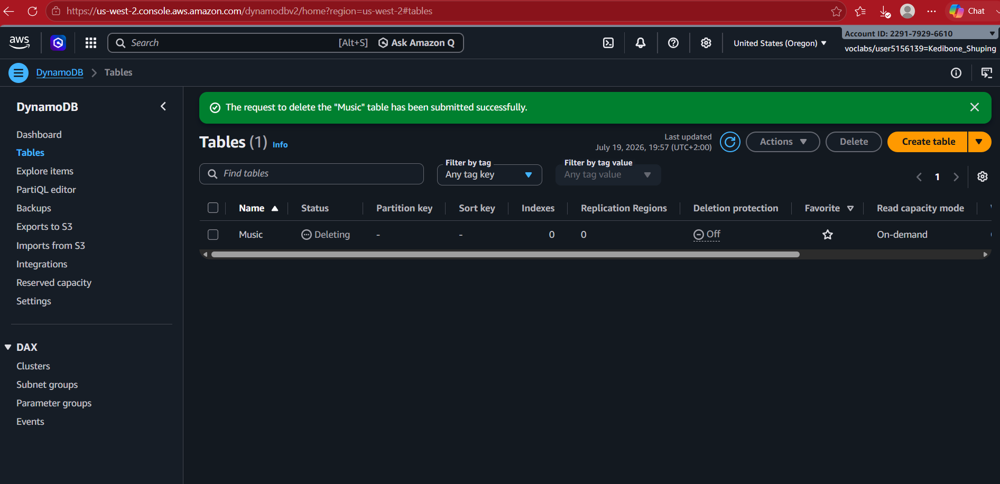

# Introduction to Amazon DynamoDB

## Overview

In this lab, I used Amazon DynamoDB to create a table for a music library. I added music records, updated an existing item, and used Query and Scan operations to retrieve information from the table.

The exercise demonstrated how DynamoDB stores data using a flexible NoSQL data model, where different items in the same table can have different attributes.

## AWS Services and Tools Used

- Amazon DynamoDB
- AWS Management Console

## Creating the Music Table

I created a table named `Music` with the following primary key structure:

- **Partition key:** `Artist` (String)
- **Sort key:** `Song` (String)

The combination of these two keys identifies each item in the table.

## Adding Music Records

I added three items to the table, each containing information about a different song.

| Artist | Song | Album | Year |
|---|---|---|---:|
| Pink Floyd | Money | The Dark Side of the Moon | 1973 |
| John Lennon | Imagine | Imagine | 1971 |
| Psy | Gangnam Style | Psy 6 (Six Rules), Part 1 | 2011 |

The items also contained additional attributes. For example, the John Lennon record included `Genre`, while the Psy record included `LengthSeconds`.

This demonstrated that DynamoDB does not require every item in a table to have exactly the same attributes.

The item form below shows the table's key attributes, `Artist` and `Song`.

## Modifying an Existing Item

After adding the records, I updated the release year for Psy's song from `2011` to `2012` and saved the changes.

## Querying the Table

I used the Query operation to retrieve the Psy record.

The search used both primary key attributes:

- `Artist`: Psy
- `Song`: Gangnam Style

The Query operation uses the table's key structure to find matching items, making it an efficient way to retrieve specific records.

## Scanning the Table

I also used the Scan operation with a filter:

- **Attribute name:** `Year`
- **Type:** Number
- **Value:** `1971`

This returned the John Lennon record for *Imagine*.

Unlike Query, Scan examines the table's items and applies the filter to the results. This makes it less efficient for retrieving specific records, particularly as a table grows.

## Troubleshooting

I initially made a mistake when configuring the table keys and had to redo the key setup. This helped me understand that the partition key and sort key are fundamental parts of a DynamoDB table's structure, rather than ordinary attributes.

## Deleting the Table

After completing the exercises, I deleted the `Music` table. Deleting the table also removes the data stored in it.

The screenshot below captures the deletion request, with the table shown in the `Deleting` state.

## What I Learned

- How to create a DynamoDB table using a partition key and sort key.
- How DynamoDB stores items with different attributes in the same table.
- How to add and update items.
- The difference between Query and Scan operations.
- Why choosing the correct key structure matters when designing a table.
- How to delete a DynamoDB table and its data.
