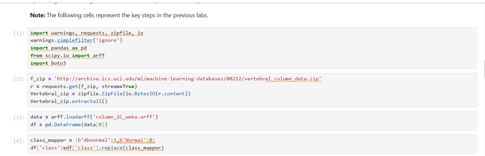
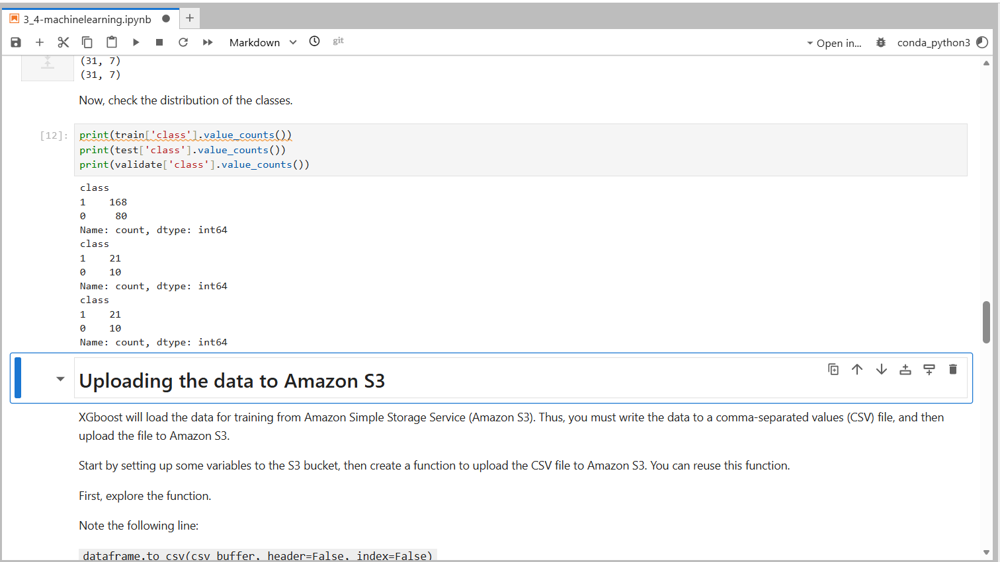
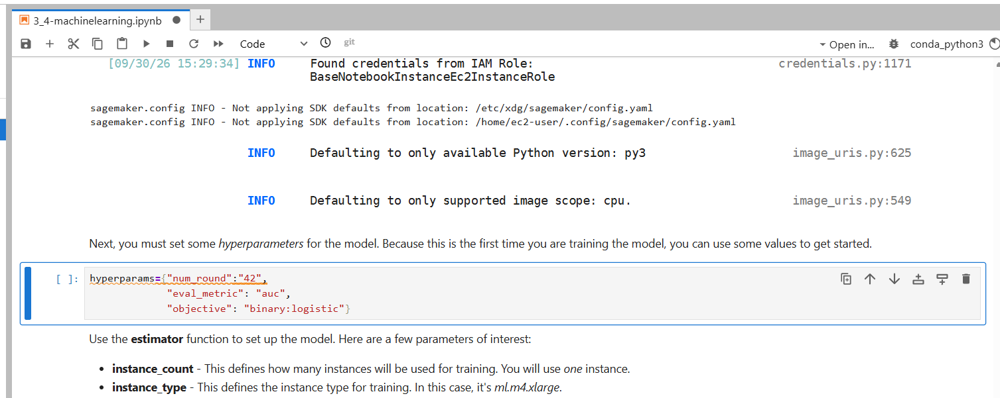
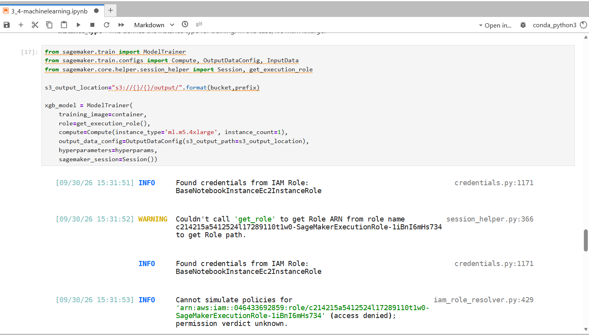
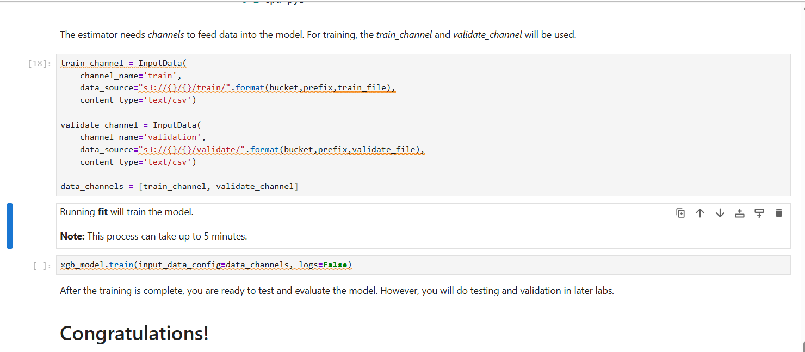
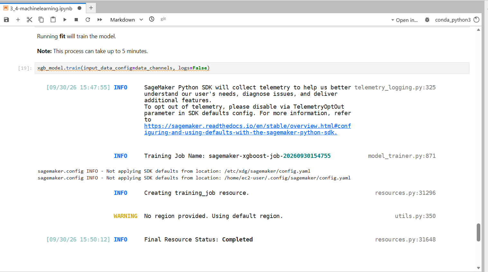

# Machine Learning

## Overview

On 30 September 2026, I prepared the UCI Vertebral Column dataset and trained an XGBoost binary classification model using Amazon SageMaker. The lab brought together Python-based data preparation, Amazon S3 storage, and a managed model-training job.

The dataset contains 310 patient records. Each record has six biomechanical features derived from the shape and orientation of the pelvis and lumbar spine. The target identifies each record as **Normal** or **Abnormal**.

## AWS Services and Tools Used

- Amazon SageMaker
- Amazon S3
- Python
- Pandas
- SciPy
- Scikit-learn
- Boto3
- XGBoost

## Project Workflow

1. Retrieved the Vertebral Column dataset from the UCI Machine Learning Repository and extracted the ARFF file.
2. Loaded the data into a Pandas DataFrame using SciPy and encoded the target labels as `Abnormal = 1` and `Normal = 0`.
3. Moved the target column, `class`, to the first position to match the input format expected by XGBoost.
4. Split the 310 records into training, validation, and test datasets using Scikit-learn's `train_test_split()`. I used stratification to preserve the class distribution and `random_state=42` to make the split reproducible.
5. Exported the three datasets as CSV files without column headers or DataFrame indexes, then uploaded them to Amazon S3 using Boto3.
6. Retrieved the XGBoost training container URI and configured a SageMaker `ModelTrainer` with one `ml.m5.4xlarge` instance.
7. Set the XGBoost hyperparameters to `binary:logistic` for the objective, `auc` for the evaluation metric, and `42` training rounds.
8. Configured the training and validation input channels to read their CSV data from S3, then started the training job.

## Data Preparation

The stratified split produced three datasets:

| Dataset | Records | Abnormal | Normal |
| --- | ---: | ---: | ---: |
| Training | 248 | 168 | 80 |
| Validation | 31 | 21 | 10 |
| Test | 31 | 21 | 10 |
| **Total** | **310** | **210** | **100** |

I uploaded all three datasets to S3 under the `lab3` prefix, in separate `train`, `validate`, and `test` folders. The SageMaker training job used the training and validation channels. The test dataset was held back for testing and evaluation in a later lab.

## Model Training Configuration

| Setting | Value |
| --- | --- |
| Algorithm | XGBoost |
| Container version | `1.0-1` |
| Objective | `binary:logistic` |
| Evaluation metric | `auc` |
| Training rounds | `42` |
| Instance type | `ml.m5.4xlarge` |
| Instance count | `1` |

SageMaker completed the training job successfully. The final resource status was **Completed**.

This confirms that the training job ran to completion. Model performance was not evaluated as part of this lab; the test dataset was reserved for a later exercise.

## Screenshots

### 1. Dataset Loading and Encoding

Loaded the UCI dataset and mapped the target labels to numeric values for binary classification.

### 2. Stratified Data Split

The output shows the resulting dataset sizes and class counts after the stratified split.

### 3. XGBoost Hyperparameters

Configured the binary classification objective, AUC evaluation metric, and 42 training rounds.

### 4. SageMaker ModelTrainer Configuration

Configured the SageMaker training environment, including the `ml.m5.4xlarge` compute instance.

### 5. Training Channels and Execution

Connected the training and validation data channels and started the XGBoost training job.

### 6. Training Job Completed

The SageMaker output shows the training job's final resource status as **Completed**.

## Skills Demonstrated

- Loaded and explored a dataset using SciPy and Pandas
- Prepared target labels for binary classification
- Used Scikit-learn to create reproducible, stratified data splits
- Exported datasets to CSV and uploaded them to Amazon S3 with Boto3
- Configured an XGBoost training job in Amazon SageMaker
- Set training hyperparameters and configured input data channels
- Submitted a managed training job and checked its completion status

## What I Learned

This lab connected the data preparation work in Python with the AWS services used to store data and run model training. I worked through the steps from loading and preparing a dataset to organising its training inputs in S3 and configuring SageMaker to run XGBoost.

It also reinforced why training, validation, and test datasets have separate roles. The training and validation data were passed to the training job, while the test data remained separate for a later evaluation exercise.
