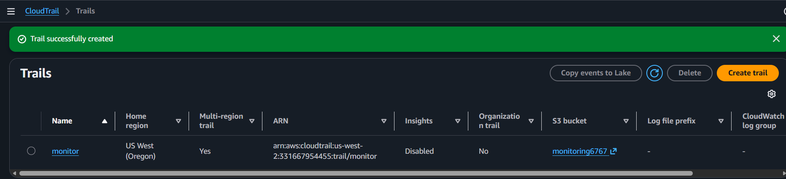
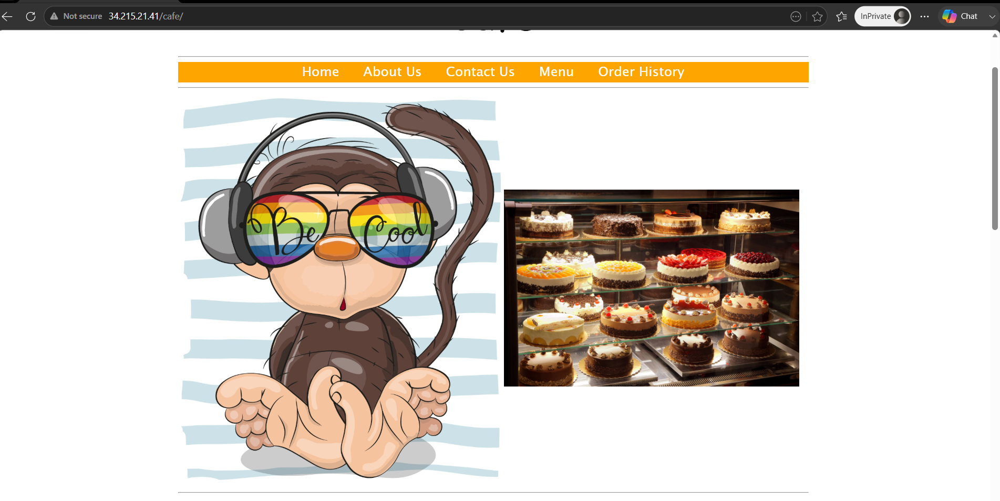
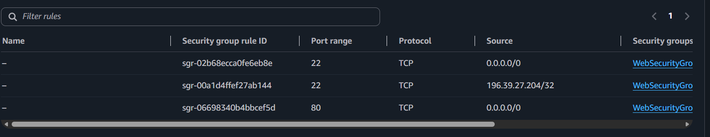
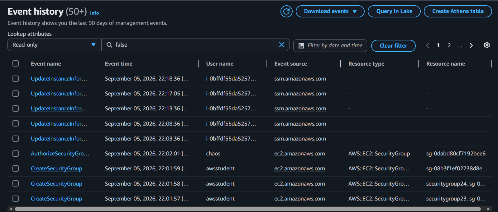
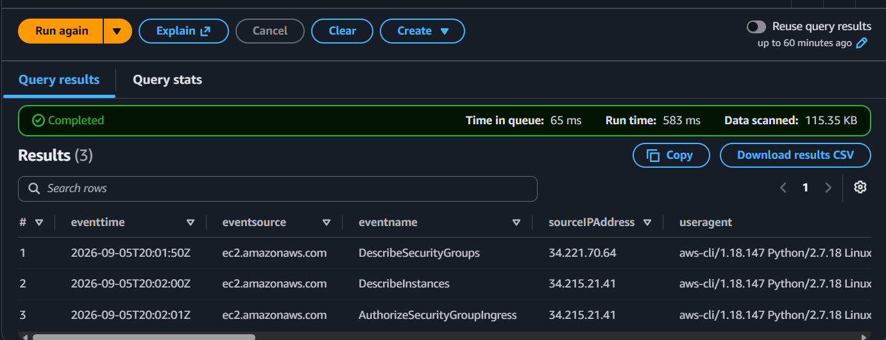
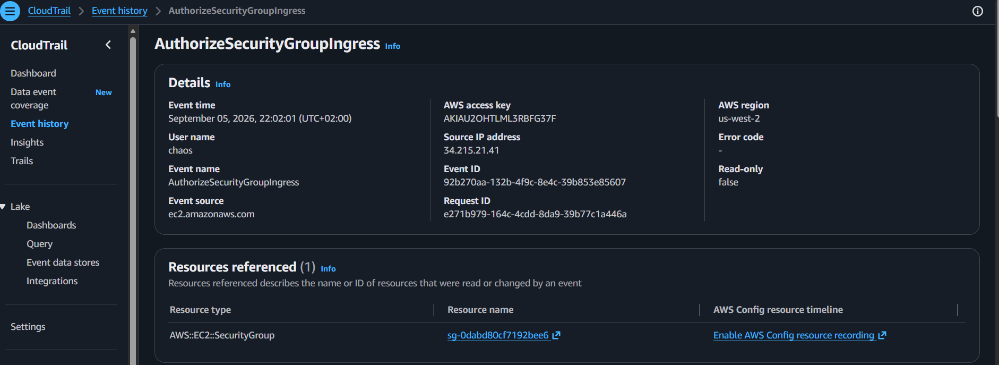
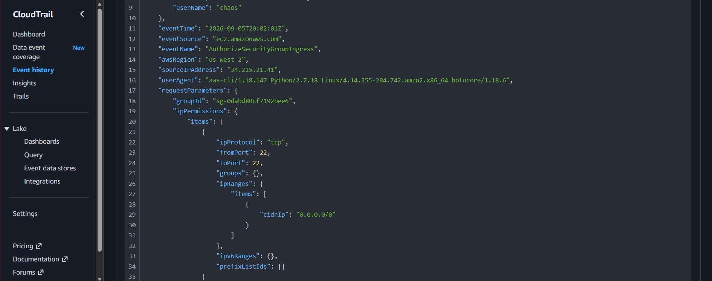

# Investigating a CloudTrail Security Incident

## Overview

I investigated a simulated security incident involving a compromised Café Web Server. The exercise focused on using AWS CloudTrail to reconstruct activity in the AWS account, identify the IAM identity behind an unauthorised security group change, and trace the activity back to its source.

I created a multi-Region CloudTrail trail named `monitor` and configured it to deliver log files to an Amazon S3 bucket named `monitoring6767`. I then used Amazon Athena to query the CloudTrail records and build a timeline of the activity.

## AWS Services and Tools Used

- AWS CloudTrail
- Amazon S3
- Amazon Athena
- Amazon EC2
- AWS Identity and Access Management (IAM)
- Linux command line
- AWS Command Line Interface (AWS CLI)

## CloudTrail Setup and Log Analysis

I created the CloudTrail trail named `monitor` and configured its S3 destination as `monitoring6767`. The trail collected management events across AWS Regions.

To make the log data easier to investigate, I used Athena with an external table named `cloudtrail_logs_monitoring6767`. I configured the Athena query-results location as:

`s3://monitoring6767/results/`

This allowed me to query the recorded API activity instead of manually opening individual CloudTrail log files.

## Reconstructing the Incident

The Athena results showed a sequence of EC2 API calls associated with the investigation:

| Time (UTC+02:00) | Event | Source IP | Identity / context |
| --- | --- | --- | --- |
| 20:01:50 | `DescribeSecurityGroups` | `34.221.70.64` | Hacker Instance |
| 20:02:00 | `DescribeInstances` | `34.215.21.41` | AWS CLI / Linux |
| 20:02:01 | `AuthorizeSecurityGroupIngress` | `34.215.21.41` | IAM user `chaos` |

The key event was `AuthorizeSecurityGroupIngress`. The CloudTrail event record identified the IAM user `chaos` and showed that the request came from `34.215.21.41`, the Café Web Server's public IP address.

The event modified security group `sg-0dabd80cf7192bee6` by adding an inbound rule that allowed SSH traffic over TCP port 22 from `0.0.0.0/0`. The new security group rule ID was `sgr-02b68ecca0fe6eb8e`.

This was the central finding of the investigation: the IAM user `chaos` made an unauthorised change that exposed SSH access to the internet.

## What the CloudTrail Records Revealed

The event details showed more than the name of the API call. I could inspect the identity that made the request, the source IP address, the event time, the AWS Region, the user agent, and the request parameters.

The user agent identified AWS CLI activity on Linux. The event also showed that the request changed the security group configuration (`readOnly: false`).

This made it possible to connect the API activity to a specific identity, source machine, and change rather than relying only on the visible symptoms on the web server.

## What I Learned

This exercise showed me how CloudTrail can be used to investigate activity across an AWS account. Each API event records details that help answer important incident questions: who made the request, what action was performed, when it happened, where it came from, and which resource was affected.

I also saw why centralising CloudTrail logs in S3 is useful. With Athena, I could query the records and build a timeline from individual API events.

The most important lesson was that a security incident can leave a sequence of traceable API calls. By examining the event identity, source IP, user agent, and request parameters together, I could identify the IAM user responsible for the public SSH rule and trace the request to the Café Web Server.

## Skills Demonstrated

- Creating a multi-Region CloudTrail trail
- Delivering CloudTrail logs to Amazon S3
- Configuring Athena to query CloudTrail log data
- Investigating AWS management events
- Reconstructing an incident timeline from API activity
- Identifying IAM identities and source IP addresses in CloudTrail records
- Analysing EC2 security group changes
- Interpreting CloudTrail event details, including user agents and request parameters
