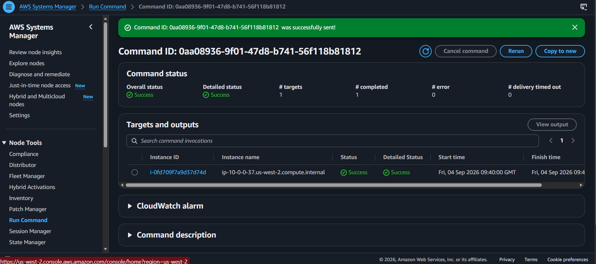
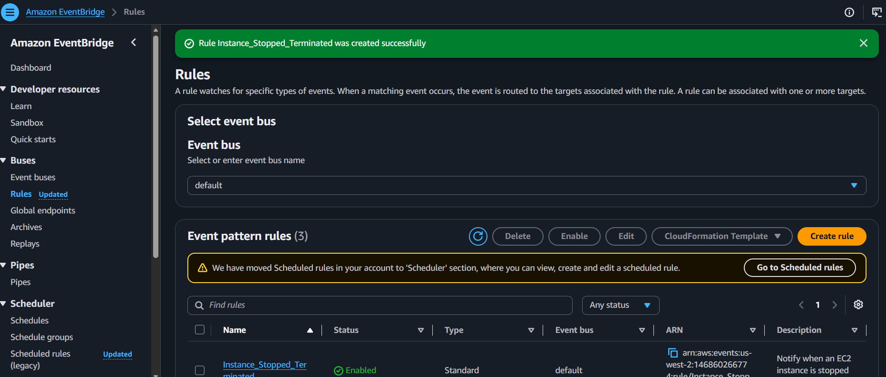

# Monitoring Infrastructure

## Overview

In this lab, I set up monitoring for an Apache web server running on an Amazon EC2 instance. I worked with the CloudWatch Agent, Systems Manager, CloudWatch Logs, metric filters and alarms, SNS notifications, EventBridge, and AWS Config.

The exercise covered several layers of monitoring: collecting information from inside the EC2 instance, tracking application errors, responding to alarms and instance state changes, and checking resource configuration against AWS Config rules.

## AWS Services and Tools Used

- Amazon EC2
- AWS Systems Manager Run Command
- AWS Systems Manager Parameter Store
- Amazon CloudWatch (Agent, Logs, Metrics, metric filters and alarms)
- Amazon SNS
- Amazon EventBridge
- AWS Config
- Apache HTTP Server

## CloudWatch Agent and Systems Manager

I used Systems Manager Run Command to prepare the CloudWatch Agent on the EC2 web server. The command execution completed successfully, and I then stored the agent configuration in Parameter Store using the name `Monitor-Web-Server`.

I used the Parameter Store configuration to configure the agent and start it on the instance.

The agent configuration was intended to collect Apache logs and system metrics from the EC2 instance. The captured evidence confirms the configuration was retrieved and the agent started. It does not include separate disk or memory metric screenshots, so I have not included those as demonstrated results here.

## CloudWatch Logs, Metric Filters and Alarms

To test log collection, I generated a 404 response from the Apache web server and checked CloudWatch Logs. The matching requests appeared in the `HttpAccessLog` log stream.

I then created a metric filter to count matching 404 events and connected the resulting metric to a CloudWatch alarm. The alarm initially stayed in the OK state even after I generated several errors. When I checked its settings, I found that it was using **Average** rather than **Sum**.

The metric filter emitted a value of 1 for each matching event, so changing the alarm statistic to Sum allowed it to count the errors as intended. The alarm eventually entered the ALARM state, and SNS delivered an email notification. The notification showed a datapoint of 7.0 against the configured threshold of 5.0.

## EventBridge and EC2 State Changes

I created an EventBridge rule named `Instance_Stopped_Terminated` to match EC2 state-change events for instances entering the `stopped` or `terminated` state. The rule was successfully created and enabled.

During rule creation, the console attempted to create an IAM role, but the lab environment did not allow that action. I changed the target configuration to use the SNS topic without an execution role, which allowed me to create the rule.

After I stopped the EC2 instance, EventBridge detected the state change and SNS delivered the notification. The instance was later terminated during lab teardown, which triggered another notification. This gave me a chance to see the rule respond to both state changes.

## AWS Config

I added the AWS Config `required-tags` managed rule to check resources for the required `project` tag.

I also worked with the `ec2-volume-inuse-check` rule for EBS volumes. The evaluation results showed noncompliant resources: the captured rules list reported one noncompliant resource for `ec2-volume-inuse-check` and 22 for `required-tags`.

These results were useful because they showed that creating a rule does not automatically make resources compliant. AWS Config evaluates the resources against the rule and reports where they do not meet its requirements. I have kept the results as they appeared rather than presenting the lab as though every resource passed.

## Troubleshooting

### CloudWatch Alarm Statistic

The 404 alarm initially remained in the OK state even after generating multiple 404 responses. I found that the alarm was using the Average statistic instead of Sum. Since the metric filter added a value of 1 for each matching 404 event, changing the statistic to Sum allowed the alarm to count the errors correctly. The alarm then entered the ALARM state and sent the SNS notification.

### EventBridge Rule Creation

EventBridge initially failed when I tried to create the rule. The console showed that AWS was attempting to create an IAM role, but the lab environment did not allow that action. Changing the configuration to use the SNS topic without an execution role allowed the rule to be created successfully.

## What I Learned

This lab gave me a chance to connect logs, metrics, alarms and events rather than treating them as separate AWS features. I could generate an application error, find it in CloudWatch Logs, turn matching log events into a metric, and use that metric to trigger an alarm and an SNS email.

The alarm statistic was a particularly useful lesson. The metric filter was producing values, but the alarm's use of Average meant it wasn't counting the errors the way I expected. Changing it to Sum fixed the behaviour.

I also had to work around the EventBridge rule's IAM role creation issue before notifications could be delivered. Once the rule was active, I could see SNS receive notifications for the EC2 instance entering both stopped and terminated states.

Finally, AWS Config gave me a view of resource compliance. The noncompliant results were part of the exercise too: they showed me how Config identifies resources that need attention, not just how to create a rule.

## Skills Demonstrated

- Configuring the CloudWatch Agent using Systems Manager and Parameter Store
- Collecting and checking Apache web server logs in CloudWatch Logs
- Creating metric filters and CloudWatch alarms
- Selecting an appropriate statistic for counting log events
- Sending alarm and EC2 state-change notifications through SNS
- Creating and troubleshooting EventBridge rules and targets
- Using AWS Config managed rules to evaluate resource configuration
- Interpreting compliant and noncompliant resource results
