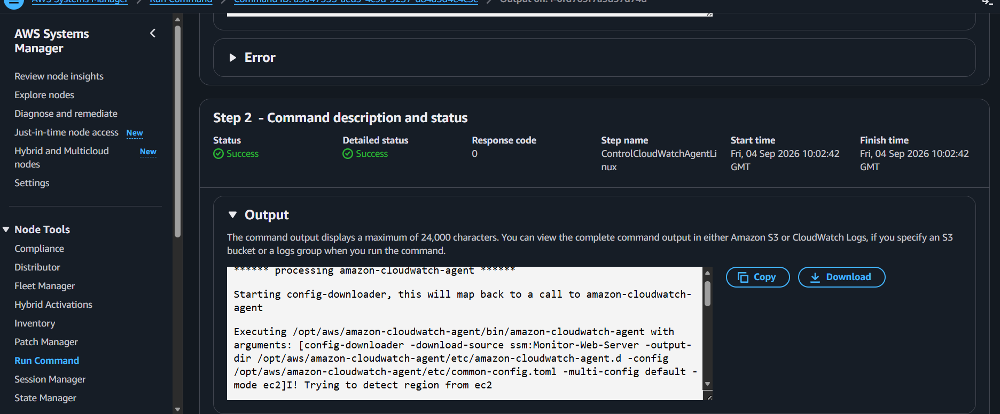
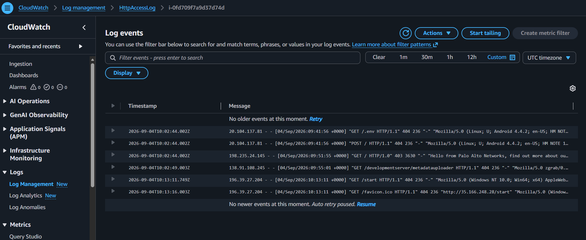
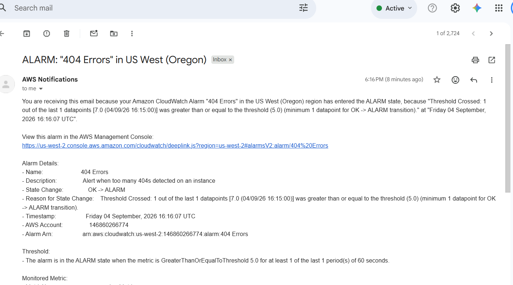
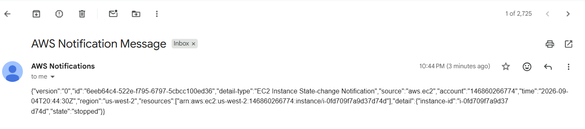

# Monitoring Infrastructure

## Overview

In this lab, I set up monitoring for an Apache web server running on an EC2 instance. I worked with the CloudWatch Agent, CloudWatch Logs, metric filters and alarms, SNS notifications, EventBridge, and AWS Config.

The lab brought together several ways of keeping track of an environment: looking inside the instance for application and system information, reacting to errors in the web server logs, receiving notifications when an alarm or EC2 state change occurred, and checking resource configuration with AWS Config.

## AWS Services and Tools Used

- Amazon EC2
- AWS Systems Manager Run Command
- AWS Systems Manager Parameter Store
- Amazon CloudWatch (Agent, Logs, Metrics, Alarms and metric filters)
- Amazon SNS
- Amazon EventBridge
- AWS Config
- Apache HTTP Server

## Project Workflow

### CloudWatch Agent and Parameter Store

I used Systems Manager Run Command to prepare the CloudWatch Agent on the EC2 instance. I stored the agent configuration in Parameter Store under the name `Monitor-Web-Server`, then ran the configuration command so the agent could retrieve the parameter and start.

### Apache Logs, Metric Filters and Alarms

I generated a 404 response from the Apache web server and checked CloudWatch Logs to confirm that the request appeared in the access log.

I then created a metric filter to count matching 404 events and connected the resulting metric to a CloudWatch alarm. The alarm initially stayed in the OK state even after I generated several errors. When I checked its settings, I found that it was using **Average** rather than **Sum**. The metric filter emitted a value of 1 for each matching event, so changing the statistic to Sum allowed the alarm to count the errors as intended.

The alarm eventually entered the ALARM state, and SNS delivered an email notification. The notification showed a datapoint of 7 against the configured threshold of 5.

### EventBridge and EC2 State Changes

I created an EventBridge rule named `Instance_Stopped_Terminated` to match EC2 state-change events for instances entering the `stopped` or `terminated` state. During rule creation, the console attempted to create an IAM role, but the lab environment did not allow that action. I changed the target configuration to use the SNS topic without an execution role, which allowed me to create the rule.

After I stopped the EC2 instance, EventBridge detected the state change and SNS delivered the notification.

The instance was later terminated during lab teardown, which triggered another notification. This gave me a chance to see the rule respond to both state changes.

### AWS Config

I added the AWS Config `required-tags` managed rule to check resources for the required `project` tag. I also configured the `ec2-volume-inuse-check` rule for EBS volumes.

The evaluation results included noncompliant resources. I therefore treat this part of the lab as practice configuring and reviewing compliance rules, not as evidence that every resource passed the checks.

## What I Learned

The CloudWatch alarm troubleshooting was one of the most useful parts of the lab. The logs were recording the 404 requests, and the metric filter was producing values, but the alarm statistic affected how those values were evaluated. Changing Average to Sum made the alarm behave as expected.

I also had to work around the EventBridge rule's IAM role creation issue before notifications could be delivered. Once the rule was in place, I could see the EC2 state change arrive through SNS.

The lab also gave me experience with AWS Config managed rules and interpreting compliance results. Adding a rule is only the beginning; the evaluation can still identify resources that need attention.

## Skills Demonstrated

- Configuring the CloudWatch Agent using Systems Manager and Parameter Store
- Collecting and checking Apache web server logs in CloudWatch Logs
- Creating metric filters and CloudWatch alarms
- Selecting an appropriate statistic for counting log events
- Sending alarm and EC2 state-change notifications through SNS
- Creating and troubleshooting EventBridge rules and targets
- Using AWS Config managed rules to evaluate resource configuration
- Interpreting compliant and noncompliant resource results
