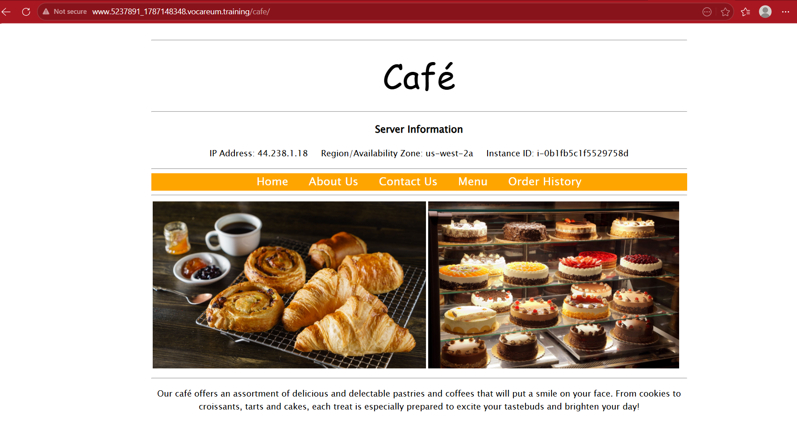
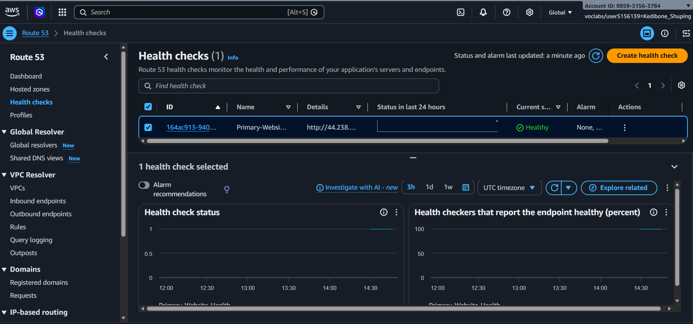
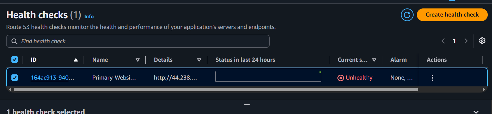
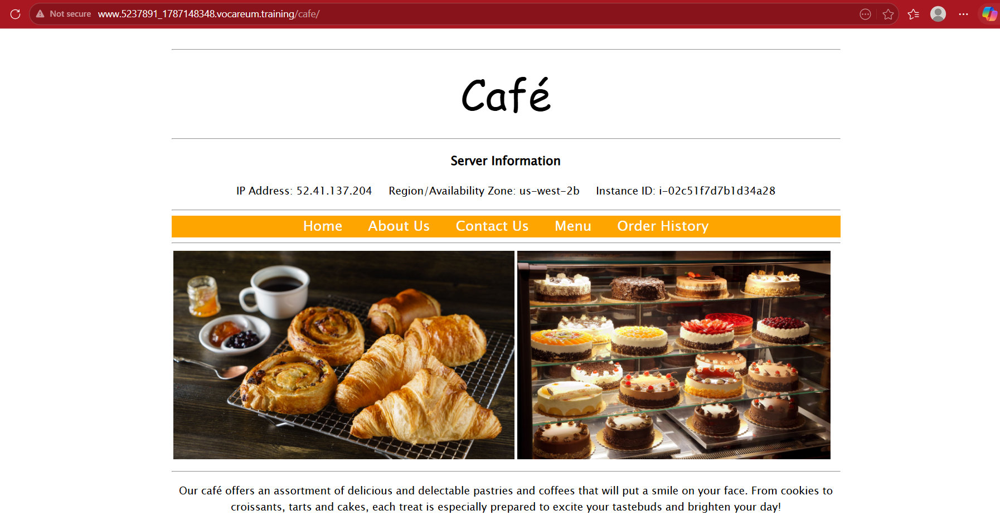

# Route 53 Failover Routing

## Overview

In this lab, I configured Amazon Route 53 failover routing for a café website hosted on two EC2 instances in separate Availability Zones.

The primary website was hosted at `44.238.1.18` in `us-west-2a`, with a secondary website at `52.41.137.204` in `us-west-2b`. I used a Route 53 health check to monitor the primary endpoint and observed what happened when its status changed from **Healthy** to **Unhealthy**.

The café website subsequently loaded from the secondary endpoint. This gave me a practical look at how Route 53 can use health checks and failover records to direct DNS responses away from an unhealthy primary endpoint.

## AWS Services and Components Used

- Amazon Route 53
- Amazon EC2
- Amazon SNS
- Amazon CloudWatch
- Route 53 Health Checks
- Failover Routing Records
- Availability Zones

## Architecture

Both web servers were deployed in **US West (Oregon), `us-west-2`**, but in different Availability Zones.

```text
                 Café website DNS name
                          |
                          v
                    Amazon Route 53
                          |
                 Failover routing records
                    /             \\
                   /               \\
             PRIMARY             SECONDARY
                |                    |
                v                    v
          Primary EC2           Secondary EC2
          us-west-2a            us-west-2b
          44.238.1.18           52.41.137.204
                |
                v
        Route 53 health check
                |
        Healthy / Unhealthy
```

The health check monitored the primary website endpoint. When the primary became unhealthy, the failover configuration allowed Route 53 to use the secondary endpoint.

This was **Availability Zone failover within one Region**, not a deployment across two AWS Regions.

## Project Workflow

I started with the café website hosted on the primary EC2 instance in `us-west-2a`, then identified the secondary website in `us-west-2b`.

The primary website was accessible at `44.238.1.18`.



I then created a Route 53 hosted zone, configured the failover routing records, and created the `Primary-Website-Health` health check for the primary endpoint. I also configured the SNS topic used for health-related notifications and confirmed its email subscription through the link sent by AWS Notifications.

## Health Checks and Notifications

The health check was named `Primary-Website-Health`. During testing, its status changed from **Healthy** to **Unhealthy**.

The initial health-check status was **Healthy**, confirming that Route 53 could reach the primary endpoint before the failover test.





The lab instructions specified the `/cafe` request path for the health check, but the captured creation form does not show the path value. I therefore cannot verify the final saved path from the available screenshot.

The captured secondary-record form also appears to show the primary health-check ID selected. The lab instructions say to leave the secondary record's health-check association blank. There is no screenshot of the final saved record, so I have not treated that setting as confirmed.

The SNS email subscription confirmation for `Primary-Website-Health` was received on **19 August 2026 at 4:38 PM**, and I confirmed the subscription using the link in the email. The separate alarm notification expected by the lab was not recovered from the inbox, so I have not used it as evidence of successful alarm-email delivery.

## Failover Demonstration

The primary café website was initially served from `44.238.1.18` in `us-west-2a`. When the primary health check changed to **Unhealthy**, Route 53 failed over to the secondary website at `52.41.137.204` in `us-west-2b`.

I was able to access the café website through the secondary instance after the primary health check failed. This was the result I was looking for: traffic was directed away from the unhealthy primary endpoint and the secondary endpoint took over.



## Skills Demonstrated

- Configured DNS failover routing with Amazon Route 53
- Worked with PRIMARY and SECONDARY failover records
- Created and monitored a Route 53 health check
- Used health status to understand endpoint availability
- Tested website availability across two Availability Zones
- Integrated Amazon SNS into a notification workflow
- Distinguished Availability Zone failover from multi-Region deployment
- Verified failover through the application endpoint, not just the console configuration

## Key Lessons Learned

Before this lab, failover routing was something I understood in theory. Seeing the health check change from Healthy to Unhealthy, and then accessing the café website through the secondary server, made the process much easier to understand.

I also got to see how Availability Zones fit into a highly available setup. Both servers were in the same AWS Region, `us-west-2`, but in different Availability Zones. That helped me understand the difference between spreading resources across Availability Zones and deploying across multiple Regions.

What made the exercise click for me was seeing the change happen: the primary endpoint became unhealthy, and the secondary endpoint served the website instead.
