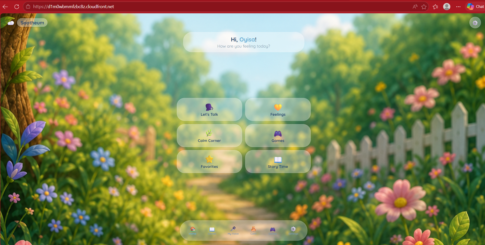
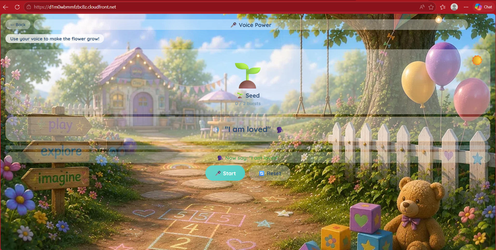
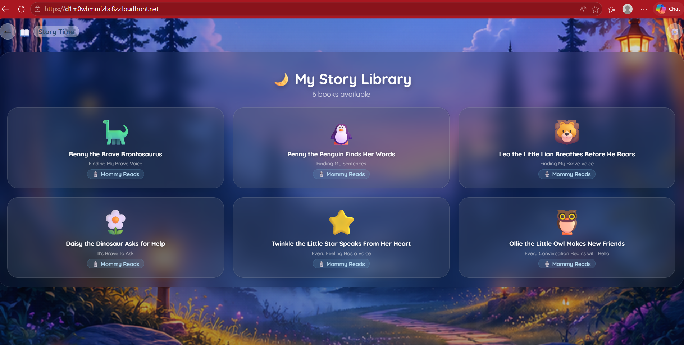
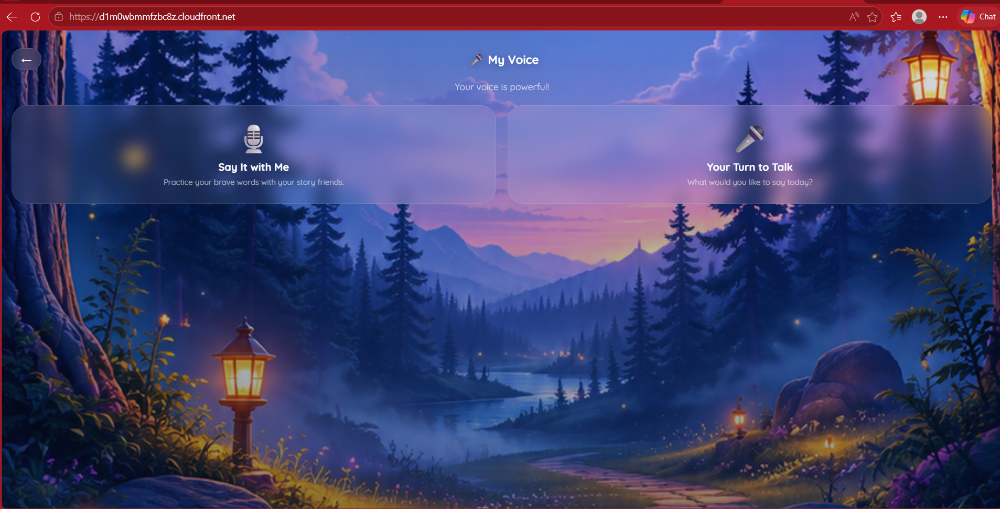
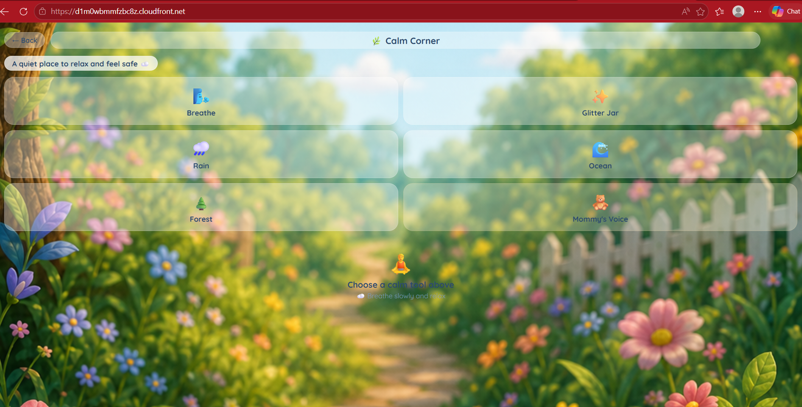

# Sootheum

*An adaptive communication and emotional-regulation app built for my daughter, who was working through a speech delay.*

Sootheum is a single-file progressive web app with six story books, five voice games, a calm corner for emotional regulation, and a custom "Mommy's Voice" feature — 126 pages of recorded narration across six books, so every story plays in a familiar voice. It was built incrementally over several months, guided by what actually worked for her. She now talks. This project is closed on her terms.

---

## Overview

Several features in Sootheum depend on live microphone input: a voice-powered game where a flower grows as the child speaks affirmations, a recording studio with playback and audio effects, and a sequencing game that listens for spoken steps. All of these failed silently when the app was served from a local development environment or from a plain HTTP endpoint.

This writeup documents the cause and the architectural fix.

## The Problem

`navigator.mediaDevices.getUserMedia()` returned a permission error — even when the browser's microphone permission was explicitly granted for the site. The application's fallback paths activated silently (e.g. "tap to grow" instead of listening for voice).

## The Cause

`getUserMedia()` is gated on a **secure context**. The browser only exposes microphone and camera access when the page is served from:

- `https://` — any TLS-secured origin
- `http://localhost` — an explicit browser exemption for development

All other origins — plain `http://`, `file://` in some browsers, and any non-trustworthy context — silently deny access. No console error by default. Just a rejected promise.

The app was deployed to a plain S3 static website endpoint, which serves over `http://`. The browser had no way to verify the site was legitimate, so it refused to grant sensor access. The code was correct. The environment was wrong.

## The Fix

Move the site behind Amazon CloudFront.

CloudFront provides two things that solved the problem:

- **HTTPS by default.** Every CloudFront distribution gets a `*.cloudfront.net` subdomain with a managed TLS certificate, putting the site into a secure context.
- **Edge caching.** Static assets are cached at AWS edge locations worldwide, reducing latency and origin load.

No application code changed. The fix was purely architectural.

## Architecture

    Browser
      │  HTTPS
      ▼
    CloudFront distribution
      │  HTTPS (origin fetch)
      ▼
    Amazon S3 bucket
      │
      ├── index.html   (single-file app)
      ├── sounds/      (mp3: narration, ambient, comfort)
      └── images/      (scene backgrounds, UI artwork)

## AWS Services and Tools Used

- Amazon S3 (static origin)
- Amazon CloudFront (HTTPS termination + CDN)
- Web Audio API (live microphone amplitude analysis)
- Web MediaRecorder API (voice recording and playback)

## What This Demonstrates

- **Browser security model.** Understanding that sensor APIs are gated on secure contexts, and that the correct response is to fix the environment rather than work around the API.
- **Deployment architecture.** S3 origin + CloudFront distribution + HTTPS via managed certificate, with awareness of edge caching implications.
- **Diagnostic discipline.** Distinguishing "broken code" from "code that violates an environment-level browser requirement."

## Technical Notes

### Narration

Every story page has a narration path. When present, the app plays the recorded file (a familiar voice reading the page). When a narration path is absent, the story reader falls back to the browser's native text-to-speech API. This keeps every story functional for any reader, regardless of whether narration has been recorded.

### Voice sensitivity

The Voice Power game measures microphone input amplitude in real time via the Web Audio API, using a smoothed RMS calculation with a moving average over several frames. Sensitivity is set as a configurable constant (default 25) rather than a hardcoded threshold — it was tuned to suit a child working on projection and vocal volume. The mechanism supports future tuning for different voices and environments.

## Troubleshooting

### Microphone access denied despite granted permission

The browser's permission prompt appeared and was accepted, but `getUserMedia()` still rejected. Investigation showed the site was being served over `http://`, which does not qualify as a secure context. Moving the site behind a CloudFront distribution resolved the issue without any code changes.

### Voice-powered flower game counted noise as input

Initial sensitivity thresholds were too low, causing background noise to trigger the flower growth mechanic. The amplitude calculation was adjusted to require sustained input above threshold — using a moving average across several frames — rather than any single frame above the threshold. The final threshold value was set to 25 after tuning for a specific child's voice.

## Verification

- Microphone input successfully captured after deployment behind CloudFront.
- Voice-powered game responded correctly to live voice input.
- Voice recording and playback worked end-to-end in a secure context.
- Text-to-speech fallback confirmed by testing a story page without a narration path.
- All story books, games, and calm corner features tested on desktop and mobile.

## Screenshots

### Home

### Voice Power

The flower grows as the child speaks affirmations. Real-time microphone analysis via the Web Audio API.

### Story Library

Six original story books, each written with a specific speech or emotional milestone in mind.

### My Voice

Two modes: guided practice ("Say It with Me") and open recording ("Your Turn to Talk"). This is the screen the HTTPS fix was for.

### Calm Corner

Regulation tools: breathing guide, glitter jar, ambient nature sounds, and a recording of the child's mother's voice for comfort.

## Live

Live at: https://d1m0wbmrmfzbc8z.cloudfront.net

---

*Built for a little girl who now talks.*
