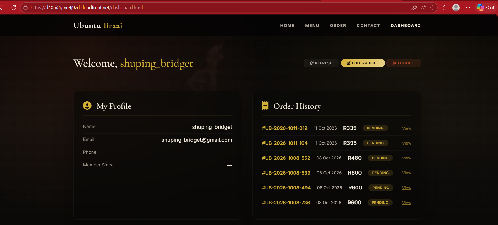

# Ubuntu Braai & Lounge

*A full-stack restaurant website built to demonstrate AWS serverless architecture and end-to-end cloud service integration.*

## Overview

Ubuntu Braai & Lounge is a restaurant website hosted on Amazon S3. I use Amazon Cognito for customer authentication and API Gateway, Lambda, and DynamoDB to handle orders.

Customers sign in, browse the menu, place an order, and view their order history on a dashboard. Orders are stored in DynamoDB, and the dashboard retrieves them by email using a Global Secondary Index.

The email on an order is not sent by the browser. The Lambda reads it from the Cognito JWT, so the customer's identity comes from the token rather than from anything the client claims.

The reservation form on the homepage has client-side validation and a confirmation message. It is presentation-only — there is no backend integration for reservations yet.

**Live website:** [Ubuntu Braai & Lounge](https://d10m2glnu4j9zd.cloudfront.net/)

## Skills Demonstrated

- Building a serverless application with Cognito-issued JWTs authorizing API Gateway requests end to end, with the API deriving identity from the token rather than trusting the client
- Debugging across layers — a transport bug and a schema bug that both presented as application failures
- Designing a DynamoDB query around a Global Secondary Index rather than scanning the table

## AWS Services and Tools Used

- **Amazon S3** — static website hosting
- **Amazon Cognito** — user authentication and JWT issuance
- **AWS Lambda** — three Node.js functions: automatic user confirmation, order creation, and order retrieval
- **Amazon API Gateway** — REST endpoints protected by a Cognito authorizer
- **Amazon DynamoDB** — order storage and customer order-history queries
- **AWS Budgets** — cost monitoring

## Challenges

### Authenticated requests failed in the browser with `Failed to fetch`

My browser requests with the `Authorization` header were failing with `TypeError: Failed to fetch`. The same JWT worked when I ran it through `curl`, and the preflight `OPTIONS` request came back successful. Only the browser failed, and only when the header was present.

I spent about two days ruling things out — cache, localhost, mixed HTTP/HTTPS, browser differences, duplicate headers, preflight status, API Gateway configuration, the Cognito authorizer. Each time I tested, each time the tests came back clean. There was even a moment where a request seemed to succeed, which turned out to be a session that had expired and fallen back to the unauthenticated path. That false positive cost me about an hour of backtracking.

The cause was the last thing I checked: the Lambda source. API Gateway's Lambda proxy integration does not add CORS headers to the response. The Lambda has to return them explicitly on every return path, and mine weren't. The success return, the validation failure, and the error path all came back without them. Six returns across two functions, none with a `headers` block.

The fix was a shared `CORS_HEADERS` constant added to every return in both Lambdas.

What I'd do differently: when the browser says `Failed to fetch` and every server-side test returns 200, the file I haven't read yet is more likely to be the problem than the configuration I've already re-checked three times. `curl` doesn't enforce CORS, so a successful response from `curl` only tells me the server processed the request — it doesn't tell me the browser can read the response.

### Orders submitted but never appeared on the dashboard

Orders were going through. The create-order Lambda returned success. But nothing showed up on the dashboard — the list call queried the `email-index` GSI and came back empty every time.

I checked the frontend, then the query logic in list-orders, then the GSI configuration. All three were correct, and I redeployed the Lambda more than once chasing a code bug that wasn't there.

The cause was in the table itself. The partition key had been created as `rderNumber` — the leading `o` was missing. From the Console it looked right. The Lambda was writing `orderNumber`. DynamoDB didn't reject the write; the declared key and the written attribute just didn't match, so the GSI query returned nothing.

I found it by opening a single item in the Console and reading the key names character by character. I deleted the table, recreated it with `orderNumber` as the partition key, recreated the GSI, and everything started flowing.

What I'd do differently: the Console's create-table form doesn't validate against the code. A one-character typo in a key name behaves exactly like a code bug. Compare the table's key names against the `PutCommand` and `QueryCommand` strings in the Lambda the same way I'd compare a URL.

### CloudFront returned 504 timeouts fetching from the S3 website endpoint

After moving the site behind CloudFront for HTTPS, every request through the CloudFront URL returned `504 Gateway Timeout`. The S3 website endpoint itself was still working — a direct request to `http://ubuntu-braai.s3-website.eu-north-1.amazonaws.com/` returned the homepage normally.

The cause was the origin protocol. CloudFront's Console had defaulted the origin to **HTTPS only**, but the S3 *website* endpoint only serves HTTP. CloudFront was trying to connect over HTTPS, getting no response, and timing out after 30 seconds.

The fix was to set the origin protocol to **HTTP only**. Browser-to-CloudFront traffic stays HTTPS, and CloudFront-to-S3 runs inside AWS's network. No security tradeoff.

What I'd do differently: when using the S3 website endpoint as a CloudFront origin, check the origin protocol before the distribution goes live. The Console allows the wrong setting at creation time and only greys it out later. This is the same trap that cost time on the CLF trainer — same root cause, different symptom (403 there, 504 here).

## What I Learned

- The layer I'm debugging isn't always the layer the symptom points at. The CORS bug looked like API Gateway configuration and was Lambda source. The DynamoDB bug looked like frontend logic and was a schema typo.
- `curl` and the browser don't enforce the same rules. A response can be perfectly valid to `curl` and unreadable to a browser, and that difference is exactly what CORS is.
- A single character in a schema can cost hours of debugging that has nothing to do with the code I was reading.

## Verification

- The site loads over HTTPS through CloudFront
- Cognito sign-in works, the session persists across pages, and logout clears the Cognito session keys from local storage so the site doesn't silently re-authenticate on return.
- Order submission writes to DynamoDB and returns a server-generated order number.
- The dashboard retrieves and displays orders by email, and a new order appears immediately.

  
