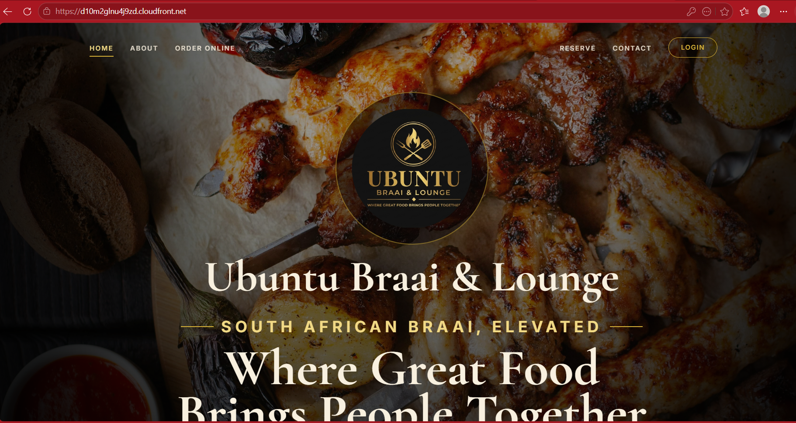
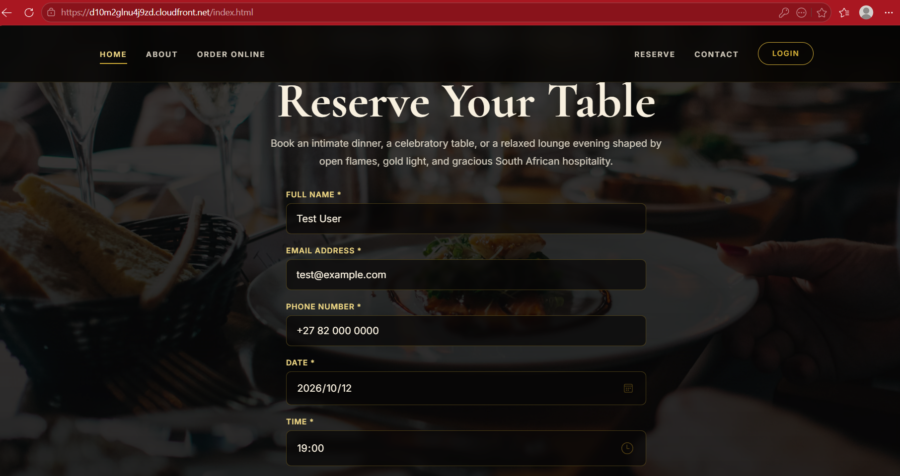
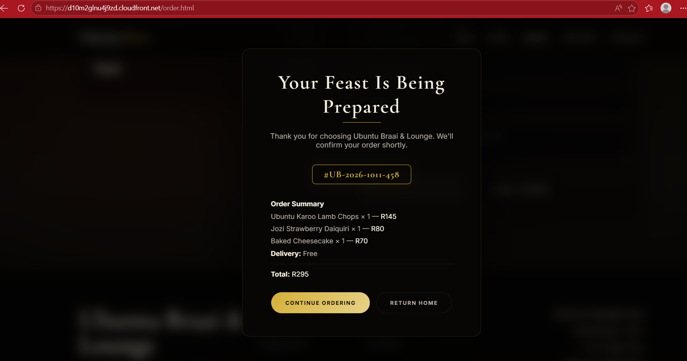

# Project 1 – Restaurant Static Website on AWS

*A static restaurant website hosted on AWS, with Cognito authentication, a serverless order backend, and a documented migration path for a small business moving off manual systems.*

## Overview

Ubuntu Braai & Lounge is a restaurant website hosted on Amazon S3 and served over HTTPS through CloudFront. Customers sign in with Amazon Cognito, browse the menu, place orders, and view their order history on a dashboard.

The order flow runs end to end: the browser sends an authenticated request to API Gateway, the Cognito authorizer validates the JWT, a Lambda function writes the order to DynamoDB, and the dashboard retrieves it by email using a Global Secondary Index. The email on each order is read from the Cognito token rather than sent by the browser, so identity is asserted by the issuer, not by the client.

This project was built against the Praesignis AWS re/Start Project 1 brief: a static restaurant website with Cognito sign-in, a database backend for bookings and orders, and a recommended migration path for a small business.

**Live website:** [Ubuntu Braai & Lounge](https://d10m2glnu4j9zd.cloudfront.net/)

## What Was Built

- **Amazon S3** – static website hosting
- **Amazon CloudFront** – HTTPS termination and content delivery
- **Amazon Cognito** – customer sign-up and sign-in, email-based, no MFA
- **AWS Lambda** – three Node.js functions: user auto-confirmation, order creation, order retrieval
- **Amazon API Gateway** – REST API with a Cognito authorizer on `/orders`
- **Amazon DynamoDB** – `ubuntu-orders` table, partition key `orderNumber`, GSI `email-index`
- **AWS Budgets** – $0.01 cost tripwire

The site includes a homepage, menu, order flow with cart and checkout, order confirmation, a signed-in dashboard showing order history, and a client-side reservation form.

## How This Meets the Brief

| Requirement | Status |
|---|---|
| Static website hosted on AWS | Delivered — S3 with CloudFront |
| Cognito sign-in for customers | Delivered — email sign-in, session persistence, logout |
| Backend + database for customer data and orders | Delivered — API Gateway, Lambda, DynamoDB |
| Order submission form and confirmation | Delivered — server-generated order number shown on confirmation |
| Booking form | Partially delivered — form is built and validates input; it does not yet persist to a backend |
| PowerPoint presentation | Content documented in this README; slide deck is the next artifact |

The booking form is the one requirement that is not fully backend-integrated. The order flow follows the same pattern the booking flow would use, so wiring reservations to a new Lambda and DynamoDB table is a straightforward extension of the deployed architecture rather than new work.

## Recommended Architecture for a Production Deployment

The deployed stack is the minimum that meets the brief. For a real restaurant moving to AWS at scale, the following services would extend it without changing the shape of the solution:

- **Amazon Route 53** – custom domain and DNS
- **Amazon SES** – order and reservation confirmation emails
- **Amazon SQS** – queueing order writes during peak periods so Lambda invocations are buffered
- **A second DynamoDB table for reservations** – mirrors the orders table, keyed on reservation number
- **Amazon Cognito user groups** – separating staff and customer roles for a proper admin interface
- **Amazon CloudWatch** – application monitoring and log retention
- **AWS IAM roles scoped per function** – least-privilege access for each Lambda

These services represent what a growing restaurant would eventually need. The deployed stack represents what a small restaurant actually needs today. The difference is not capability — it is scale. The current architecture can be extended into the recommended one without rebuilding anything.

An admin dashboard (`admin.html`) was built alongside the customer-facing site to manage order status. It currently reads from local storage and uses a client-side password check, and it is not wired into the current Cognito and API architecture. Rebuilding it against the deployed stack is a recommended next step.

## Cost Analysis

The deployed stack runs within AWS's free tiers at the traffic levels this site sees.

| Service | Free allowance | Current cost |
|---|---|---|
| AWS Lambda | 1M requests, 400K GB-s per month | $0.00 |
| Amazon DynamoDB | 25 GB storage, 25 RCU/WCU | $0.00 |
| Amazon Cognito | 50,000 monthly active users | $0.00 |
| Amazon S3 | 5 GB storage, 20K GETs, 2K PUTs per month | $0.00 |
| Amazon API Gateway | 1M REST API calls per month | $0.00 |
| Amazon CloudFront | 1 TB data out, 10M requests per month | $0.00 |

DynamoDB on-demand pricing and Lambda per-request billing scale with actual usage rather than provisioned capacity, so a restaurant pays for orders that actually happened rather than for servers standing by. At current traffic levels, total spend to date is $0.00.

**Cost controls:** an AWS Budgets tripwire is configured at $0.01 to alert on any spend. If the account starts accruing charges — through traffic growth, a misconfigured service, or a forgotten resource — the alert fires before the cost becomes meaningful.

The comparison to the restaurant's current manual system is straightforward. Paper-based booking and order tracking has no direct AWS cost, but it has a staffing cost — hours spent reconciling bookings, correcting order mix-ups, and confirming reservations by phone. The cloud version reduces that labour, and the infrastructure cost is lower than one hour of staff time per month.

## Verification

- The site loads over HTTPS through CloudFront.
- Cognito sign-in works, the session persists across pages, and logout clears the session keys from local storage.
- Order submission writes to DynamoDB and returns a server-generated order number.
- The dashboard retrieves and displays orders by email, and a new order appears immediately.

## Presentation

The brief calls for a PowerPoint presentation covering the restaurant's overview, challenges, AWS services, cost analysis, and migration benefits. The content for that presentation is documented in this README — the Overview, Recommended Architecture, Cost Analysis, and Verification sections together form the presentation's substance. A slide deck is the next artifact.

## Live

[https://d10m2glnu4j9zd.cloudfront.net/](https://d10m2glnu4j9zd.cloudfront.net/)

