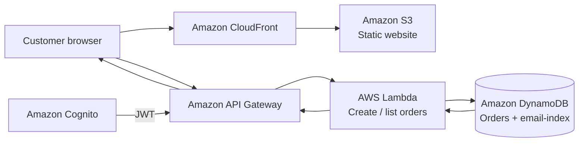

# Project 1 – Restaurant Static Website on AWS

*A restaurant website built for the AWS re/Start Project 1 brief — with a working customer order journey, Cognito authentication, a serverless backend, and a practical migration path for a small business.*

## Ubuntu Braai & Lounge

Ubuntu Braai & Lounge is a restaurant website hosted on Amazon S3 and served over HTTPS through CloudFront. Customers can browse the restaurant experience, sign in, place orders, and return to a dashboard to view their order history.

**[Visit the live website](https://d10m2glnu4j9zd.cloudfront.net/)**

The website brings together the customer-facing experience and the AWS services behind it. The homepage includes a reservation form; the menu leads into a cart and checkout flow; and successful orders receive a server-generated order number.

### The customer journey

- **Discover:** the homepage introduces Ubuntu Braai & Lounge.
- **Browse:** customers explore the menu and select items.
- **Order:** the cart and checkout flow submit an order to the backend.
- **Confirm:** the customer receives an order confirmation with a generated order number.
- **Return:** signed-in customers can view their order history on the dashboard.

The reservation form is currently front-end only: it validates the input and displays a confirmation, but does not yet save reservations to a backend.

## How the AWS pieces work together

The order flow runs end to end. The browser sends an authenticated request to API Gateway, the Cognito authorizer validates the JWT, a Lambda function writes the order to DynamoDB, and the dashboard retrieves orders by email using a Global Secondary Index.

The email attached to an order is read from the Cognito token rather than sent by the browser. The backend therefore uses the identity asserted by the token issuer instead of trusting a client-supplied email address.

## What was built

| AWS service | Role in the project |
|---|---|
| **Amazon S3** | Hosts the static website |
| **Amazon CloudFront** | Serves the site over HTTPS |
| **Amazon Cognito** | Customer sign-up and sign-in, with session persistence |
| **Amazon API Gateway** | REST API with a Cognito authorizer on `/orders` |
| **AWS Lambda** | Three Node.js functions: user auto-confirmation, order creation, and order retrieval |
| **Amazon DynamoDB** | `ubuntu-orders` table, partition key `orderNumber`, and GSI `email-index` |
| **AWS Budgets** | $0.01 cost tripwire |

The application includes a homepage, menu, cart and checkout, order confirmation, a signed-in dashboard with order history, and a client-side reservation form. An admin dashboard (`admin.html`) was also built to manage order status, but it currently uses local storage and a client-side password check; it is not integrated with the deployed Cognito/API architecture.

## How this meets the brief

| Requirement | Status |
|---|---|
| Static website hosted on AWS | **Delivered** — S3 with CloudFront |
| Cognito sign-in for customers | **Delivered** — email sign-in, session persistence, logout |
| Backend and database for customer data and orders | **Delivered** — API Gateway, Lambda, DynamoDB |
| Order submission and confirmation | **Delivered** — server-generated order number shown to the customer |
| Booking form | **Partially delivered** — form validates input, but does not persist reservations to a backend |
| PowerPoint presentation | README documents the project substance; slide deck remains the next artifact |

The booking form is the one brief requirement not yet fully backend-integrated. The existing order flow provides a pattern for extending the application: reservations could be connected to a new Lambda function and a separate DynamoDB table.

## Verification

- The site loads over HTTPS through CloudFront.
- Cognito sign-in works, the session persists across pages, and logout clears the session keys from local storage.
- Order submission writes to DynamoDB and returns a server-generated order number.
- The dashboard retrieves and displays orders by email, and a new order appears immediately.

## Cost analysis

The deployed stack has been running within the applicable AWS free-tier allowances at the traffic levels observed during development. Actual eligibility and charges depend on account terms, usage, and current AWS pricing.

| Service | Allowance referenced during project work | Recorded cost |
|---|---|---|
| AWS Lambda | 1M requests and 400K GB-seconds per month | $0.00 |
| Amazon DynamoDB | 25 GB storage, 25 RCU/WCU | $0.00 |
| Amazon Cognito | 50,000 monthly active users | $0.00 |
| Amazon S3 | 5 GB storage, 20K GETs, 2K PUTs per month | $0.00 |
| Amazon API Gateway | 1M REST API calls per month | $0.00 |
| Amazon CloudFront | 1 TB data out, 10M requests per month | $0.00 |

DynamoDB on-demand pricing and Lambda per-request billing scale with usage rather than requiring application servers to remain running. At the time of this project check, total spend to date was $0.00.

**Cost control:** an AWS Budgets alert is configured at $0.01 to flag unexpected spend early, including charges caused by increased traffic or forgotten resources.

The comparison with a manual restaurant workflow is not simply “cloud is free.” Paper-based order and booking management has labour costs too: reconciling orders, correcting mix-ups, and confirming reservations. The deployed architecture demonstrates a route to reducing that administrative work, while keeping the infrastructure small and extendable.

## Recommended production extensions

The deployed stack meets most of the brief at the scale of a small demonstration. A production restaurant could extend it with:

- **Amazon Route 53** — custom domain and DNS
- **Amazon SES** — order and reservation confirmation emails
- **Amazon SQS** — buffer asynchronous work during demand spikes, where the workload warrants it
- **A reservations table in DynamoDB** — persist booking requests separately from orders
- **Amazon Cognito user groups** — separate staff and customer permissions
- **Amazon CloudWatch** — application monitoring and log retention
- **Scoped AWS IAM roles** — least-privilege access for each Lambda function

These are proposed extensions, not services currently deployed for this project. The intent is to extend the existing design where the business needs it, rather than add services simply for the sake of a larger architecture.

## Presentation

The brief calls for a PowerPoint presentation covering the restaurant overview, challenges, AWS services, cost analysis, and migration benefits. This README covers those topics; the slide deck is the next artifact.

**[Explore Ubuntu Braai & Lounge live](https://d10m2glnu4j9zd.cloudfront.net/)**
